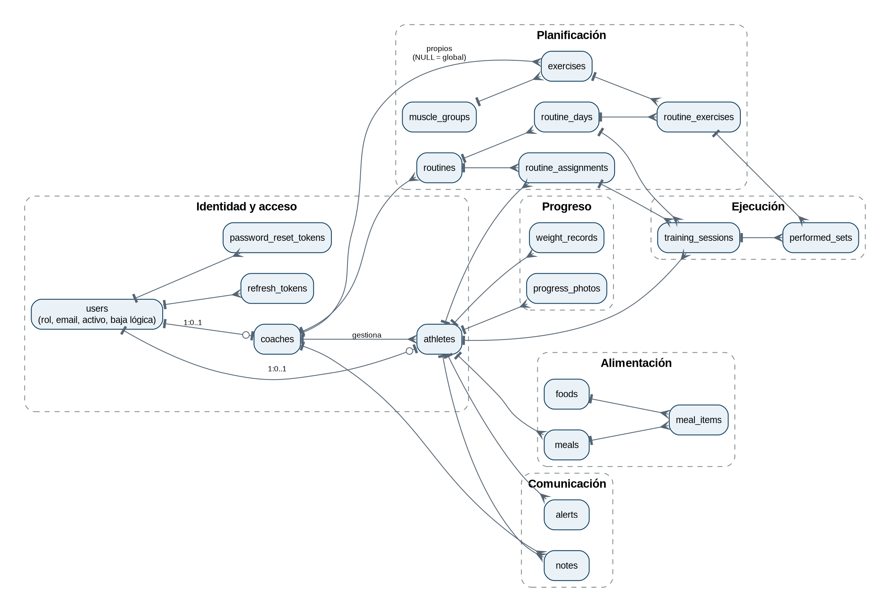
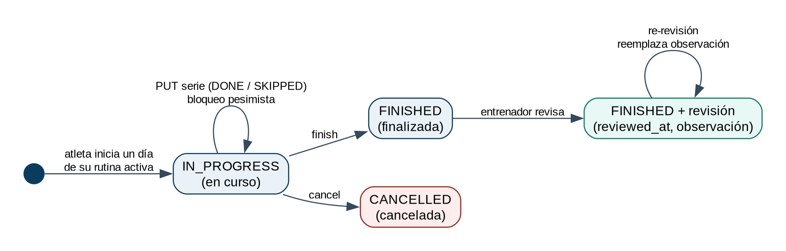
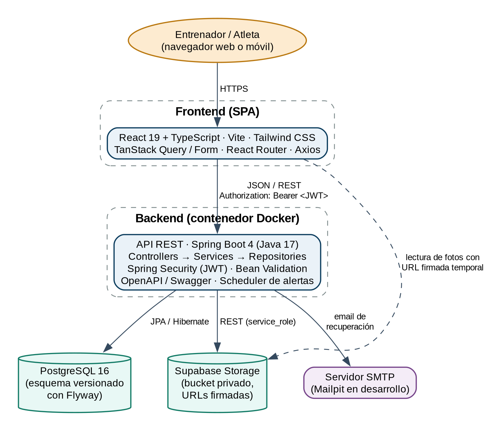

# Plataforma de Gestión Deportiva

**Universidad Tecnológica Nacional**

**Tecnicatura Universitaria en Programación a Distancia**

**Materia:** Proyecto Final

**Proyecto:** Plataforma de Gestión Deportiva — aplicación web para entrenadores personales y sus atletas

**Grupo N.º:** 151

**Integrantes:**

- Alexis Da Silva
- Joel Dario Muñoz

**Año:** 2026

**Repositorio:** https://github.com/jdario9912/tp-integrador-final

**Video final:** _[completar: enlace al video de demostración]_

---

## 1. Problema y contexto

### 1.1 Situación que dio origen al proyecto

La idea nace de una necesidad concreta del ámbito del entrenamiento personal. Un entrenador personal en actividad, que participa del proyecto como usuario piloto, realiza el seguimiento de su cartera de atletas con una planilla de Excel por atleta. En cada planilla administra rutinas, planificación, registros diarios de entrenamiento, peso corporal y observaciones.

Excel resulta suficiente cuando la cartera es chica, pero no escala: a medida que crece la cantidad de atletas, también crece la cantidad de archivos, y la información de cada atleta queda aislada en su propia planilla. Esto produce una gestión fragmentada: no hay una visión global de la cartera, el tiempo dedicado a tareas administrativas aumenta y la experiencia empeora tanto para el entrenador como para el atleta, que tiene que interpretar hojas de cálculo y termina enviando sus datos por mensajes sueltos de WhatsApp.

### 1.2 Usuarios y actores involucrados

- **Entrenador personal (COACH):** gestiona su cartera de atletas, diseña rutinas, las asigna y supervisa el cumplimiento, la alimentación y el progreso físico de cada atleta.
- **Atleta (ATHLETE):** consulta su rutina, registra sus entrenamientos en el momento, carga lo que come, registra su peso y sube fotos de progreso.
- **Sistema:** evalúa diariamente la cartera de cada entrenador y genera alertas automáticas (inactividad, falta de rutina, bajo cumplimiento, etc.).

### 1.3 Evidencia utilizada para validar el problema

- **Caso real y observación directa:** el trabajo cotidiano del entrenador piloto y sus planillas de Excel, que muestran qué datos registra realmente (rutinas por día, series, repeticiones, cargas, peso, observaciones) y dónde aparecen las fricciones.
- **Entrevistas informales con el entrenador piloto**, que identificaron dos puntos de dolor centrales: la fricción en la carga (si registrar una serie lleva demasiados pasos, el atleta abandona y vuelve a WhatsApp) y la pérdida de trazabilidad histórica (comparar la evolución de cargas durante meses en Excel es difícil sin romper fórmulas).
- **Análisis de alternativas existentes:** se compararon aplicaciones SaaS del rubro (por ejemplo, Harbiz o TrainingPeaks), que tienen costos mensuales elevados en dólares, una curva de aprendizaje alta y requieren instalar una aplicación nativa, con la alternativa informal (Excel + WhatsApp + PDF).
- **Análisis asistido por IA:** se usó IA como herramienta de "estrés de idea", con un rol de _Product Manager_ y otro de entrenador senior, para cuestionar el alcance y detectar requisitos indispensables. El análisis completo está en el documento _01 - Definición de la problemática y propuesta técnica_.

### 1.4 Necesidad concreta que se buscó resolver

Reemplazar las planillas aisladas por **un único espacio web centralizado** donde el entrenador vea el estado de toda su cartera y el detalle de cada atleta, y donde el atleta registre su actividad desde el celular en pocos pasos, sin interpretar hojas de cálculo.

---

## 2. Objetivos y alcance

### 2.1 Objetivo general

Desarrollar una plataforma web centralizada, con arquitectura cliente-servidor sobre una API REST, que optimice la gestión de atletas, la prescripción de rutinas y el seguimiento del entrenamiento, la alimentación y el progreso físico, reemplazando el uso de planillas de cálculo individuales.

### 2.2 Objetivos específicos

1. Implementar una API REST segura en Java con Spring Boot, con autenticación JWT y control de acceso por rol y por pertenencia de los datos.
2. Construir un frontend web _responsive_, pensado primero para el celular, con React y TypeScript.
3. Persistir los datos en PostgreSQL con integridad referencial y un esquema versionado, y almacenar las fotos en un almacenamiento privado.
4. Asegurar la calidad con pruebas automatizadas (unitarias, de integración y end-to-end) ejecutadas en integración continua.

### 2.3 Alcance finalmente implementado

Todo lo que se lista a continuación está implementado, integrado entre frontend y backend, y cubierto por pruebas automatizadas.

| Módulo                      | Funcionalidades implementadas                                                                                                                                                                                       |
| --------------------------- | ------------------------------------------------------------------------------------------------------------------------------------------------------------------------------------------------------------------- |
| Autenticación y acceso      | Registro de entrenador, inicio y cierre de sesión con JWT (access token + refresh token rotativo), una sesión activa por usuario, recuperación de contraseña por email, control de acceso por rol y por pertenencia |
| Gestión de atletas          | Alta del atleta por su entrenador, edición, desactivación y reactivación, desvinculación, baja lógica, listado "Mis atletas" con búsqueda y filtros, ficha del atleta                                               |
| Catálogo de ejercicios      | 12 grupos musculares precargados, ejercicios globales del sistema y ejercicios propios de cada entrenador (alta, edición y baja lógica)                                                                             |
| Rutinas                     | Alta y edición, estructura de días y ejercicios (series, repeticiones, peso recomendado, descanso, RIR/RPE, nota técnica), duplicación, plantillas reutilizables                                                    |
| Asignación                  | Asignación de una rutina a un atleta, con una sola rutina activa por atleta e historial de asignaciones; cálculo de vigencia y del día que le toca entrenar                                                         |
| Ejecución del entrenamiento | Iniciar, retomar, finalizar y cancelar una sesión; registro en vivo de cada serie (realizada u omitida, con peso, repeticiones y RPE); resumen con volumen total                                                    |
| Revisión de entrenamientos  | Historial de sesiones cerradas con filtro por fechas; revisión del entrenador con una observación que el atleta ve                                                                                                  |
| Alimentación                | Catálogo global de alimentos, registro de comidas por tipo con alimentos y cantidades, cálculo de calorías y macronutrientes, resumen diario, vista semanal de constancia y revisión de comidas por el entrenador   |
| Progreso físico             | Registro y corrección del peso corporal (uno por día), gráfico de evolución, fotos de progreso (frontal, lateral, espalda) en almacenamiento privado con URLs firmadas                                              |
| Dashboards                  | Panel del entrenador con métricas de la cartera (atletas activos, sin rutina, sesiones sin revisar, sin peso reciente); panel del atleta con la rutina de hoy, las comidas, el último peso y las notas              |
| Comunicación                | Notas del entrenador (privadas o visibles para el atleta, con confirmación de lectura); alertas automáticas con severidad y su atención                                                                             |

### 2.4 Funcionalidades que quedaron fuera y razones del recorte

| Funcionalidad                                                | Estado                                                                     | Razón                                                                                                                                                     |
| ------------------------------------------------------------ | -------------------------------------------------------------------------- | --------------------------------------------------------------------------------------------------------------------------------------------------------- |
| Medidas corporales (cintura, pecho, brazo, % de grasa, etc.) | En desarrollo: pull requests abiertos en ambos repositorios, sin integrar  | Se priorizó el peso y las fotos, que ya cubren el seguimiento corporal básico; las medidas se dejaron para el final del cronograma                        |
| Foto de cada comida                                          | No implementada (la columna `photo_path` existe en la base pero no se usa) | Se priorizó el registro nutricional por alimentos, que es lo que permite calcular calorías y macros                                                       |
| Despliegue en producción (VPS, Nginx, HTTPS)                 | No realizado                                                               | El backend ya está contenedorizado con Docker y tiene un perfil `prod` con variables obligatorias, pero el despliegue en un VPS queda como trabajo futuro |
| Aplicaciones móviles nativas                                 | Excluida desde el inicio                                                   | La aplicación web _responsive_ cubre el uso desde el celular sin instalar nada                                                                            |
| Integración con wearables (Garmin, Apple Watch, Strava)      | Excluida desde el inicio                                                   | Fuera del plazo académico                                                                                                                                 |
| Pasarela de pagos y cobro de cuotas                          | Excluida desde el inicio                                                   | No forma parte del problema que se buscó resolver                                                                                                         |
| Generación de dietas con IA                                  | Excluida desde el inicio                                                   | La plataforma registra datos; no prescribe planes automáticamente                                                                                         |

**Cambios respecto de la propuesta inicial.** El frontend se planificó con Astro y finalmente se construyó como una aplicación de una sola página (SPA) con React y Vite: casi toda la aplicación es interactiva y requiere sesión, así que el renderizado del lado del servidor que ofrece Astro no aportaba beneficios. El backend se planificó con Java 21 y se implementó con Java 17, que también es una versión LTS y es la que usan el contenedor y la integración continua.

---

## 3. Análisis y modelo

### 3.1 Principales entidades y relaciones

El modelo de datos tiene 31 tablas en PostgreSQL, organizadas en seis áreas. La siguiente figura muestra las entidades principales; se omiten las tablas de catálogo (roles, sexos, niveles de experiencia, estados, tipos de comida, de foto, de nota y de alerta, severidades).

_Figura 1. Entidades principales y sus relaciones (diagrama simplificado). El DER completo está en `documentacion/DER Mermaid.md` y el diagrama de clases en `documentacion/Diagrama de Clases UML.md`._

- **Identidad:** `users` guarda las credenciales, el rol y el estado de la cuenta. `coaches` y `athletes` especializan a `users` (herencia _JOINED_: comparten la clave primaria). Un entrenador gestiona muchos atletas; un atleta pertenece a lo sumo a un entrenador.
- **Planificación:** una rutina (`routines`) pertenece a un entrenador y se compone de días (`routine_days`), cada uno con ejercicios planificados (`routine_exercises`) que referencian al catálogo (`exercises`, clasificados por `muscle_groups`). Una rutina se asigna a atletas a través de `routine_assignments`.
- **Ejecución:** una sesión de entrenamiento (`training_sessions`) es la ejecución de un día de la rutina asignada; cada serie registrada (`performed_sets`) referencia la sesión y el ejercicio planificado.
- **Alimentación:** una comida (`meals`) tiene ítems (`meal_items`) que referencian el catálogo de alimentos (`foods`).
- **Progreso:** registros de peso (`weight_records`) y fotos de progreso (`progress_photos`).
- **Comunicación:** notas del entrenador (`notes`) y alertas automáticas (`alerts`).

### 3.2 Reglas de negocio relevantes

- **Pertenencia:** un entrenador solo accede a los datos de sus atletas vinculados; un atleta solo a los suyos. Un atleta desvinculado conserva su historial, pero su ex entrenador deja de verlo.
- **Una sola rutina activa por atleta.** Asignar otra cuando ya hay una activa requiere una confirmación explícita (`replaceActive`); la anterior queda inactiva en el historial. No se puede asignar una rutina sin días o con días sin ejercicios.
- **Vigencia de la rutina:** rige desde la fecha de asignación durante `durationWeeks` semanas (fin = asignación + 7 × semanas − 1). Una rutina vencida se sigue mostrando, pero no permite iniciar entrenamientos.
- **Día que toca:** es el siguiente, por número de día, al del último entrenamiento _finalizado_ de la asignación activa; después del último día vuelve al primero. Las sesiones canceladas no cuentan.
- **Una sola sesión en curso por atleta.** Una sesión pasa de `IN_PROGRESS` a `FINISHED` o `CANCELLED` y, una vez cerrada, no admite cambios. Solo las sesiones finalizadas se pueden revisar.
- **Series:** cada serie prescrita (de 1 a `sets`) se registra como realizada (con peso y repeticiones obligatorios, RPE opcional) u omitida (con motivo obligatorio). Registrar una serie es idempotente: reenviar la misma solicitud no la duplica.
- **Integridad del plan:** no se puede quitar de una rutina un día que ya tiene sesiones ni un ejercicio con series registradas, ni dar de baja un ejercicio del catálogo que usa alguna rutina.
- **Peso:** un registro por día, entre 20 y 300 kg, nunca con fecha futura. "Hoy" se calcula en la zona horaria de Argentina, no en UTC.
- **Nutrición:** cada ítem copia el nombre y los valores del alimento al cargarse, para que el historial no cambie si después se corrige el catálogo. Las calorías y los macros los calcula el backend (cantidad × valor de referencia / porción de referencia, redondeado a 2 decimales). Si el atleta edita una comida ya revisada, la revisión se descarta.
- **Alertas:** cinco condiciones con su severidad (inactividad de 14 días: crítica; sin rutina vigente y bajo cumplimiento semanal: advertencia; sin peso en 7 días y sesiones sin revisar: información). Nunca hay dos alertas abiertas del mismo tipo para el mismo atleta y, una vez atendida, ese tipo no se reabre durante 7 días.

### 3.3 Decisiones de modelado importantes

- **Herencia JOINED para usuarios:** `users` concentra autenticación y rol, y cada tipo de usuario agrega sus propios datos sin columnas nulas.
- **Catálogos como tablas** (roles, estados, tipos, severidades) en lugar de textos libres, con integridad referencial. Los umbrales y los mensajes de las alertas también viven en un catálogo, así que se ajustan sin tocar código.
- **Baja lógica** (`deleted_at`) en usuarios y ejercicios: conserva el historial y permite reutilizar el email o el nombre gracias a **índices únicos parciales** (`WHERE deleted_at IS NULL`).
- **Restricciones en la base, no solo en la aplicación:** índices únicos parciales para "una rutina activa por atleta", "una sesión en curso por atleta" y "una alerta abierta por tipo y atleta"; restricciones `CHECK` que exigen, por ejemplo, hora de fin solo en sesiones cerradas, o que una observación siempre tenga fecha de revisión.
- **Valores derivados sin columnas:** el resumen de una sesión, la vigencia de la rutina y los totales nutricionales se calculan en cada consulta, para que no puedan quedar desactualizados.
- **Rutas de objetos, no URLs:** de cada foto se guarda la ruta dentro del bucket; la URL firmada se genera en cada consulta.
- **Esquema versionado** con 18 migraciones Flyway (`V1` a `V19`), una por historia de usuario que modificó la base.

_Figura 2. Ciclo de vida de una sesión de entrenamiento._

---

## 4. Arquitectura y tecnologías

### 4.1 Arquitectura final

La solución sigue una arquitectura **cliente-servidor**: una SPA consume una **API REST monolítica** que intercambia JSON. El backend se organiza **por módulo funcional** (auth, athlete, routine, training, meal, weight, photo, alert, etc.) y, dentro de cada módulo, en capas: _controller_ (HTTP y validación), _service_ (reglas de negocio y transacciones), _repository_ (acceso a datos), _model_ (entidades JPA) y _dto_.

_Figura 3. Componentes de la solución y sus integraciones._

El código se reparte en tres repositorios: `tpif-backend` y `tpif-frontend`, donde se desarrolla, y `tp-integrador-final`, el repositorio de entrega, que los incorpora con `git subtree`. Cada merge a `main` en un subrepositorio dispara un workflow que sincroniza automáticamente el repositorio de entrega.

### 4.2 Componentes, tecnologías y su responsabilidad

| Capa            | Tecnología                                                   | Responsabilidad y motivo de la elección                                                                                                                    |
| --------------- | ------------------------------------------------------------ | ---------------------------------------------------------------------------------------------------------------------------------------------------------- |
| Frontend        | React 19 + TypeScript                                        | Interfaz de usuario. React por el dominio previo del equipo y su ecosistema; TypeScript para tipar los contratos con la API y detectar errores al compilar |
| Frontend        | Vite                                                         | Servidor de desarrollo y build. Arranque rápido y proxy hacia la API en desarrollo (evita CORS)                                                            |
| Frontend        | Tailwind CSS                                                 | Estilos _mobile-first_, consistentes y sin hojas de estilo sueltas                                                                                         |
| Frontend        | TanStack Query                                               | Caché de datos del servidor, reintentos e invalidación tras cada mutación                                                                                  |
| Frontend        | TanStack Form · React Router · Axios                         | Formularios con validación, ruteo con rutas protegidas por rol y cliente HTTP con interceptores para el token                                              |
| Backend         | Java 17 + Spring Boot 4                                      | API REST. Ecosistema maduro, tipado fuerte y soporte integrado para seguridad, validación y persistencia                                                   |
| Backend         | Spring Security + OAuth2 Resource Server                     | Autenticación JWT _stateless_ y autorización por rol en cada endpoint                                                                                      |
| Backend         | Spring Data JPA / Hibernate                                  | Mapeo objeto-relacional, repositorios y consultas paginadas                                                                                                |
| Backend         | Bean Validation                                              | Validación declarativa de las solicitudes, con errores por campo                                                                                           |
| Backend         | Flyway                                                       | Migraciones versionadas: la base se crea y actualiza igual en desarrollo, pruebas y CI                                                                     |
| Backend         | springdoc-openapi                                            | Documentación interactiva de la API (Swagger UI)                                                                                                           |
| Base de datos   | PostgreSQL 16                                                | Integridad referencial, índices únicos parciales, restricciones `CHECK` y bloqueos por fila                                                                |
| Almacenamiento  | Supabase Storage                                             | Fotos en un bucket privado, servidas con URLs firmadas que vencen                                                                                          |
| Email           | SMTP (Mailpit en desarrollo)                                 | Envío del enlace de recuperación de contraseña                                                                                                             |
| Infraestructura | Docker + Docker Compose                                      | Imagen _multi-stage_ del backend, ejecutada con un usuario sin privilegios; Compose levanta API, PostgreSQL y Mailpit                                      |
| Calidad         | JUnit 5, Testcontainers, Vitest, Testing Library, Playwright | Pruebas unitarias, de integración y end-to-end (ver sección 6)                                                                                             |
| CI              | GitHub Actions                                               | En cada pull request y en cada push a `main` corre las pruebas y el build de cada repositorio                                                              |

### 4.3 Integraciones realizadas

- **Supabase Storage:** el backend sube las imágenes con la API REST de Storage usando la clave `service_role`, que nunca llega al navegador. El acceso pasa por un puerto `ObjectStorage` (subir, firmar URL, borrar) con un adaptador `SupabaseObjectStorage`, así que el proveedor se puede reemplazar sin tocar la lógica de negocio. Si Supabase no responde, la API devuelve 503 con un mensaje genérico, sin dejar filas ni objetos huérfanos.
- **SMTP:** envío del email de recuperación con `spring-boot-starter-mail`, con _timeouts_ para que un servidor colgado no bloquee la solicitud. El SMTP no forma parte del _health check_: si el correo falla, la API sigue sana.
- **Frontend ↔ backend:** contrato REST documentado con OpenAPI y un formato común de errores (`ApiErrorResponse`) y de paginación (`PageResponse`).

### 4.4 Seguridad, autenticación, autorización y concurrencia

**Autenticación**

- JWT firmado con un _access token_ de 15 minutos y un _refresh token_ de 2 horas que **rota en cada uso**: el token usado deja de servir.
- Una sola sesión activa por usuario: iniciar sesión en otro dispositivo cierra la anterior. El cierre de sesión revoca el refresh token.
- Contraseñas con hash BCrypt (de 8 caracteres a 72 bytes, el límite de BCrypt).
- **Recuperación de contraseña:** responde 202 exista o no el email, así no revela qué cuentas existen. Guarda solo el hash SHA-256 de un token aleatorio de 256 bits, de un solo uso y con vencimiento de 30 minutos. Al cambiar la contraseña se revocan todas las sesiones.
- En el frontend, un interceptor agrega el token a cada solicitud y, ante un 401, hace **un único refresh compartido** entre las solicitudes simultáneas (el backend rota el refresh token, así que dos refresh en paralelo invalidarían la sesión).

**Autorización**

- **Por rol**, declarada en `SecurityConfig`: sin token responde 401 y con un rol que no corresponde, 403.
- **Por pertenencia**, con `AthleteAccessGuard` en la capa de servicio (no solo en el controller): un entrenador solo accede a sus atletas y un atleta solo a sus datos.
- Las notas privadas se filtran en la consulta a la base, así que nunca llegan a una respuesta para el atleta.
- CORS restringido a los orígenes configurados; en producción, `JWT_SECRET` y `CORS_ALLOWED_ORIGINS` son obligatorios (sin ellos la aplicación no arranca).
- Las rutas por rol del frontend son solo de interfaz: si se llama a la API directamente, el backend igual responde 403.

**Concurrencia y consistencia**

- **Registro de series:** la sesión se lee con un **bloqueo pesimista** (`SELECT … FOR UPDATE`), así que dos registros simultáneos se ejecutan uno tras otro y una finalización concurrente espera a que terminen.
- **Invariantes garantizadas por la base:** índices únicos parciales impiden dos sesiones en curso para el mismo atleta (también con dos inicios simultáneos), dos rutinas activas o dos alertas abiertas del mismo tipo.
- **Idempotencia:** el registro de una serie es un `PUT` sobre la serie; reenviarlo después de un corte de red no duplica datos.
- **Consistencia con Storage:** la fila de la foto se inserta solo después de subir y firmar el objeto; si algo falla, el objeto se borra.
- **Aislamiento de fallos:** las alertas se evalúan en una transacción por atleta (si falla uno, el resto continúa) y cada métrica del dashboard se consulta por separado, para que una falla no arrastre a las demás.

**Fechas y zona horaria**

- Los instantes se guardan en UTC y "hoy" se calcula en `America/Argentina/Buenos_Aires`, tanto en el backend como en el frontend: a las 22:00 de Argentina en UTC ya es el día siguiente.

---

## 5. Implementación

### 5.1 Principales módulos desarrollados

El backend tiene 16 módulos funcionales, más los paquetes transversales `common` y `config`, y unas 450 clases Java; el frontend, 26 páginas organizadas por módulo (cada una con sus acciones, _hooks_ y componentes). El desarrollo se organizó por historias de usuario (US) con una rama y un pull request por historia, revisión entre los integrantes, _conventional commits_ (verificados con commitlint y Husky) y CI obligatoria antes del merge.

| Módulo (backend)             | Pantallas principales (frontend)                                           |
| ---------------------------- | -------------------------------------------------------------------------- |
| `auth`, `coach`, `user`      | Inicio, registro de entrenador, login, recuperar y restablecer contraseña  |
| `athlete`                    | Mis atletas, agregar atleta, ficha del atleta, editar atleta               |
| `exercise`                   | Catálogo de ejercicios, nuevo y editar ejercicio                           |
| `routine`, `assignment`      | Mis rutinas, detalle, edición, estructura de días y ejercicios, asignación |
| `training`                   | Mi rutina, entrenamiento en curso, historial de entrenamientos             |
| `food`, `meal`               | Catálogo de alimentos, comidas del día con resumen nutricional             |
| `weight`, `photo`, `storage` | Progreso: peso, gráfico de evolución y fotos                               |
| `dashboard`, `alert`, `note` | Panel del entrenador y del atleta, alertas, notas                          |

### 5.2 Recorridos o casos de uso importantes

**Caso 1 — Alta de un atleta y asignación de una rutina (entrenador)**

1. El entrenador se registra e inicia sesión.
2. Da de alta al atleta con sus datos personales, de salud y su objetivo; el atleta ya puede iniciar sesión con sus credenciales.
3. Crea una rutina, configura sus días y ejercicios desde el catálogo y la asigna desde la ficha del atleta. Si el atleta ya tenía una rutina activa, la aplicación pide confirmación para reemplazarla.

**Caso 2 — Entrenamiento en vivo (atleta)**

1. En _Mi rutina_, el atleta ve resaltado el día que le toca y elige «Iniciar entrenamiento».
2. En la pantalla del entrenamiento registra cada serie como realizada (peso, repeticiones, RPE) u omitida (motivo). Si se corta la conexión, reenviar no duplica nada; si cierra el navegador, al volver puede retomar la sesión en curso.
3. Al finalizar ve el resumen: series prescritas, realizadas, omitidas, pendientes y volumen total en kg.

**Caso 3 — Seguimiento y revisión (entrenador)**

1. El panel del entrenador muestra cuántos atletas están sin rutina, sin peso reciente o con sesiones sin revisar, con enlace a cada ficha.
2. Desde la ficha revisa el historial de entrenamientos y la alimentación de la semana, y deja observaciones que el atleta ve.
3. Atiende las alertas automáticas ordenadas por severidad y deja notas privadas o visibles para el atleta.

**Caso 4 — Progreso (atleta)**

1. Registra su peso del día y ve el gráfico de evolución por rango de fechas.
2. Sube fotos de progreso: el archivo se valida en el navegador (JPG, PNG o WebP y hasta 5 MB) y de nuevo en el servidor, que detecta el formato por la firma del contenido y no por la extensión.

> _[Espacio para capturas de pantalla de la aplicación: panel del entrenador, ficha del atleta, entrenamiento en curso, comidas del día y progreso.]_

### 5.3 Dificultades técnicas y cómo se resolvieron

| Dificultad                                                                                                                                | Solución                                                                                                                                                    |
| ----------------------------------------------------------------------------------------------------------------------------------------- | ----------------------------------------------------------------------------------------------------------------------------------------------------------- |
| Registros de series simultáneos, o un registro mientras se finaliza la sesión, podían dejar datos inconsistentes                          | Bloqueo pesimista de la fila de la sesión durante el registro y la finalización, y `PUT` idempotente por serie                                              |
| Dos inicios de sesión casi simultáneos podían crear dos entrenamientos en curso                                                           | Índice único parcial en la base: la segunda inserción falla y la API responde 409                                                                           |
| El refresh token rota en cada uso, así que varias solicitudes que recibían un 401 a la vez disparaban varios refresh y cerraban la sesión | En el frontend, un único refresh compartido por todas las solicitudes que esperan                                                                           |
| Las URLs firmadas de las fotos vencen mientras el usuario mira la galería                                                                 | El backend firma una URL nueva en cada consulta; el frontend vuelve a pedir la foto una sola vez si la URL venció o falló la carga, sin reintentar en bucle |
| Diferencias de fecha entre UTC y Argentina (un registro de las 22 h quedaba en el día siguiente)                                          | Zona horaria de la aplicación configurable (`APP_TIME_ZONE`) y un `Clock` inyectable; el frontend usa la misma zona                                         |
| Consultas N+1 en historiales y dashboards                                                                                                 | Consultas agregadas: el resumen de todas las sesiones de una página y cada métrica del dashboard salen de una sola consulta                                 |
| Mantener un único repositorio de entrega con dos repositorios de desarrollo                                                               | `git subtree` más un workflow que sincroniza el repositorio contenedor después de cada merge                                                                |
| Probar contra una base real sin depender del entorno de cada integrante                                                                   | Testcontainers levanta un PostgreSQL temporal en cada corrida, tanto en local como en CI                                                                    |

---

## 6. Pruebas y validación

### 6.1 Qué aspectos fueron probados

- **Reglas de negocio** de cada servicio: vigencia de rutinas, día que toca, cálculo nutricional, resúmenes de sesión, condiciones de alerta.
- **Persistencia:** repositorios y consultas contra PostgreSQL real, migraciones Flyway y restricciones de la base.
- **API completa por HTTP:** los tests end-to-end del backend levantan la aplicación en un puerto aleatorio y prueban cada endpoint con sus códigos de estado.
- **Seguridad:** matriz de roles y pertenencia, rotación y revocación de tokens, CORS.
- **Interfaz:** componentes, _hooks_ y páginas (unitarias), y recorridos completos en el navegador, incluida la vista de celular (end-to-end).

### 6.2 Volumen de pruebas

| Repositorio | Tipo                       | Herramientas                                       | Cantidad                           |
| ----------- | -------------------------- | -------------------------------------------------- | ---------------------------------- |
| Backend     | Unitarias e integración    | JUnit 5, Mockito, Spring Boot Test, Testcontainers | 135 clases de prueba en total      |
| Backend     | End-to-end de la API       | Testcontainers + cliente HTTP                      | 26 de esas clases (una por módulo) |
| Backend     | Total                      | —                                                  | ≈ 1.420 casos de prueba            |
| Frontend    | Unitarias y de componentes | Vitest, Testing Library                            | 234 archivos de prueba             |
| Frontend    | End-to-end en navegador    | Playwright                                         | 29 especificaciones                |
| Frontend    | Total                      | —                                                  | ≈ 1.430 casos de prueba            |

### 6.3 Casos de prueba relevantes

- **Matriz de roles (`RoleEndpointMatrixE2ETest`):** recorre todos los endpoints y verifica la respuesta sin token (401), con el rol equivocado (403) y con el correcto. **Falla si se agrega un endpoint sin su fila en la matriz**, así que ningún endpoint queda sin regla de acceso.
- **Pertenencia:** un entrenador que consulta un atleta ajeno o desvinculado recibe 403; un atleta que consulta datos de otro, 403; un recurso inexistente, 404.
- **Sesiones de entrenamiento:** iniciar una segunda sesión en curso devuelve 409; registrar una serie en una sesión cerrada, 409; una serie fuera de rango o un ejercicio que no es del día, 422; reenviar la misma serie no la duplica.
- **Asignación:** asignar con otra rutina activa sin confirmación devuelve 409 con el nombre de la activa; con `replaceActive` la anterior pasa a inactiva.
- **Autenticación:** reutilizar un refresh token ya usado devuelve 401; después del logout, el refresh devuelve 401; un token de recuperación vencido o ya usado devuelve 400.
- **Fotos:** un GIF o un PDF devuelve 415 aunque se renombre como `.jpg` (se detecta por la firma); más de 5 MB devuelve 413; una falla de Storage devuelve 503 sin dejar fila ni objeto.
- **Almacenamiento real (`SupabaseObjectStorageRealIT`):** sube una imagen al Supabase real y comprueba que la URL firmada responde antes de vencer, falla después y que sin firma no hay acceso.
- **Frontend E2E:** login y logout, alta de atleta, estructura de rutinas, registro de series, finalización del entrenamiento, comidas y resumen diario, fotos de progreso, alertas y notas. Varios recorridos se ejecutan también en un viewport de celular y verifican que no haya scroll horizontal.

### 6.4 Demostración de las reglas críticas

| Regla crítica                  | Cómo se garantiza                                           | Cómo se comprueba                                                    |
| ------------------------------ | ----------------------------------------------------------- | -------------------------------------------------------------------- |
| Acceso por rol                 | Reglas en `SecurityConfig`                                  | `RoleEndpointMatrixE2ETest` sobre todos los endpoints                |
| Acceso por pertenencia         | `AthleteAccessGuard` en los servicios                       | Tests E2E de cada módulo con atletas propios, ajenos y desvinculados |
| Una sesión en curso por atleta | Índice único parcial + validación en el servicio            | E2E: el segundo inicio responde 409                                  |
| Registro concurrente de series | Bloqueo pesimista + `PUT` idempotente                       | E2E de series: reenvíos y registro después del cierre                |
| Estados de la sesión           | Restricciones `CHECK` + validaciones del servicio           | E2E de finalización, cancelación y revisión                          |
| Una rutina activa              | Índice único parcial + confirmación explícita               | E2E de asignación                                                    |
| Seguridad de tokens            | Rotación, revocación y hash del token de recuperación       | E2E de autenticación y recuperación                                  |
| Integración con Storage        | Puerto + adaptador, URLs firmadas, compensación ante fallos | Tests con Storage simulado y prueba contra el Supabase real          |

### 6.5 Evidencia de funcionamiento

- **Integración continua:** cada pull request y cada push a `main` ejecuta, en GitHub Actions, las pruebas unitarias, las end-to-end y el build de cada repositorio. Las últimas ejecuciones de `main` terminaron con éxito en ambos repositorios (noviembre de 2026).
- **Reportes:** el backend genera el reporte de JUnit en `build/reports/tests/test/index.html`; el frontend, el reporte de Playwright.
- **Documentación viva de la API:** Swagger UI en `/swagger-ui.html`, verificada por `OpenApiE2ETest`.
- **Video de demostración:** _[completar: enlace al video final]_.

### 6.6 Validación con el usuario real

El entrenador piloto participó en la definición del problema y de las funcionalidades, y validó los flujos principales a medida que se desarrollaban.

### 6.7 Resultados obtenidos

Se implementaron e integraron los módulos comprometidos en los requisitos funcionales RF-01 a RF-06 (autenticación, gestión de atletas, rutinas, entrenamiento en vivo, seguimiento de peso y fotos, y registro nutricional), además de funcionalidades que surgieron durante el desarrollo: dashboards de ambos roles, revisión de entrenamientos y comidas, notas, alertas automáticas y recuperación de contraseña. Todas las pruebas automatizadas pasan en la integración continua.

---

## 7. Resultados y conclusiones

### 7.1 Qué logró resolver el proyecto

- **Centralización:** la información de todos los atletas (rutinas, entrenamientos, alimentación, peso, fotos y notas) está en un único sistema, en lugar de una planilla por atleta.
- **Visión global de la cartera:** el panel y las alertas le indican al entrenador a quién atender primero, algo que con Excel requería revisar archivo por archivo.
- **Registro sin fricción:** el atleta registra cada serie desde el celular en el momento, con la sesión que se retoma si se interrumpe.
- **Trazabilidad histórica:** el historial de sesiones, el volumen por entrenamiento y la evolución del peso quedan disponibles sin fórmulas ni archivos que crecen.
- **Privacidad:** las fotos de progreso dejan de circular por chats y se guardan en un almacenamiento privado, con acceso temporal.

### 7.2 Qué cambió respecto de la situación inicial

| Antes (Excel + WhatsApp)                                       | Después (Plataforma de Gestión Deportiva)                                |
| -------------------------------------------------------------- | ------------------------------------------------------------------------ |
| Una planilla por atleta, sin vista de conjunto                 | Cartera completa con dashboard y alertas                                 |
| El atleta interpreta la planilla y envía sus datos por mensaje | El atleta ve su rutina del día y registra las series en la aplicación    |
| Comparar cargas en el tiempo requiere fórmulas frágiles        | Historial de sesiones con resumen y volumen calculados automáticamente   |
| Fotos dispersas en chats                                       | Fotos en un bucket privado con URLs firmadas                             |
| Sin registro estructurado de la alimentación                   | Comidas con calorías y macros calculados, resumen diario y vista semanal |

### 7.3 Limitaciones conocidas

- La aplicación **no está desplegada en producción**: se ejecuta localmente con Docker Compose.
- Las **medidas corporales** no están integradas (están en desarrollo) y las comidas no admiten foto.
- No hay **notificaciones push ni por email** de las alertas: el entrenador las ve al entrar al panel.
- El catálogo de alimentos es común a todos los entrenadores y cualquiera puede editarlo.
- La evaluación de alertas se hace al consultarlas y en un job diario, no en tiempo real.
- El refresh token de 2 horas obliga a volver a iniciar sesión después de ese tiempo sin uso.

### 7.4 Evolución futura

**Implementado y probado** es todo lo descrito en las secciones 2.3 a 6. Lo siguiente es **trabajo futuro, no implementado**:

1. Despliegue en un VPS con Nginx como _reverse proxy_, HTTPS y el frontend publicado en un hosting estático.
2. Integrar las medidas corporales y su evolución.
3. Fotos de comidas.
4. Notificaciones de alertas y recordatorios por email o push.
5. Gráficos de progresión de cargas por ejercicio.
6. Convertir la aplicación en PWA para usarla como app instalada y con soporte sin conexión durante el entrenamiento.
7. Validación prolongada con más entrenadores para medir la adopción.

### 7.5 Aprendizajes y decisiones relevantes

- **Llevar las invariantes a la base de datos** (índices únicos parciales, `CHECK`, bloqueos) dio garantías que la validación en la aplicación sola no ofrece frente a solicitudes concurrentes.
- **Las pruebas end-to-end con base real** (Testcontainers) detectaron errores que los tests con mocks no veían, y la matriz de roles evitó endpoints sin protección.
- **Trabajar por historia de usuario**, con pull request, revisión y CI obligatoria, mantuvo el código estable a lo largo de todo el desarrollo.
- **Acotar el alcance a tiempo** (MVP primero, medidas y fotos de comidas después) permitió entregar los módulos centrales completos y probados en lugar de muchos módulos a medias.
- **Elegir tecnologías por el problema y no por la propuesta inicial** (React SPA en lugar de Astro) simplificó la arquitectura.
- **Diseñar con puertos y adaptadores** las integraciones externas (Storage) permitió probarlas de forma aislada y deja abierto el cambio de proveedor.

---

## Enlaces

- Repositorio de entrega: https://github.com/jdario9912/tp-integrador-final
- Backend: https://github.com/jdario9912/tpif-backend
- Frontend: https://github.com/jdario9912/tpif-frontend
- **Video final:** _[completar: enlace al video de demostración]_
